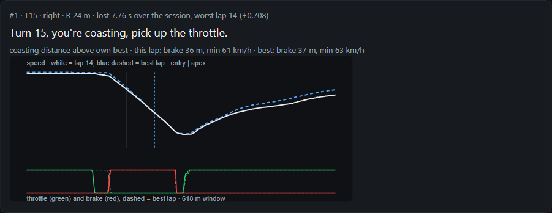
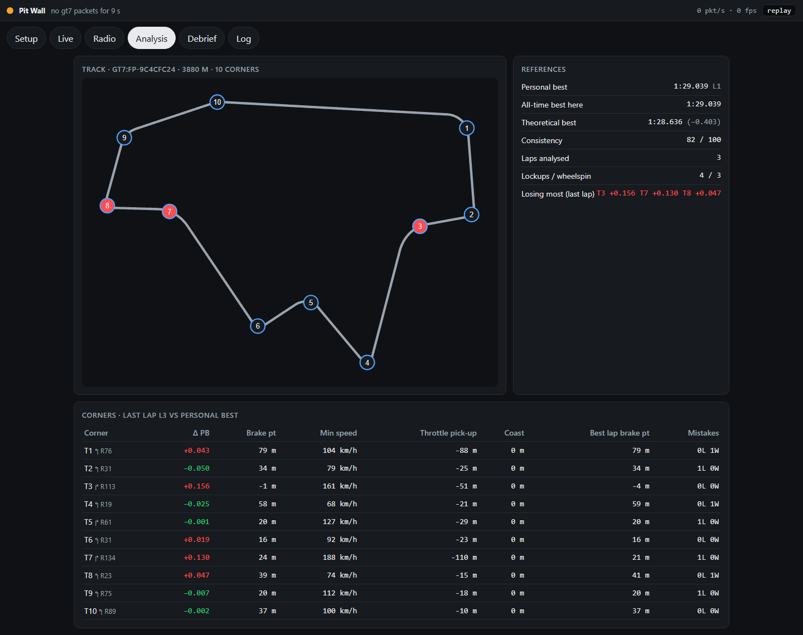
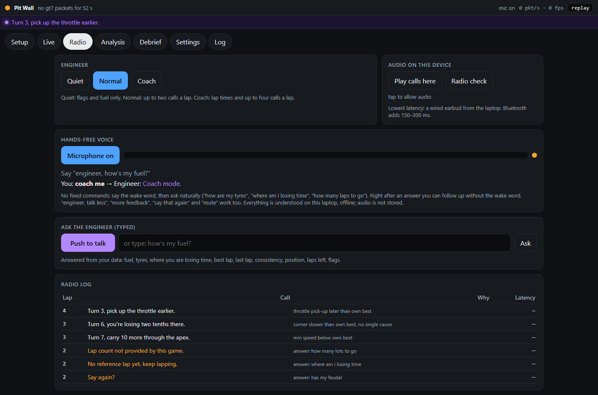

# Pit Wall — your race engineer for PS5

Pit Wall listens to your game's telemetry on your home network, learns how you drive, talks to you over the radio like a real engineer, and gives you a debrief after the session. Works with **EA SPORTS F1 25** (with or without the 2026 Season Pack) and **Gran Turismo 7** on PS5. Runs on a Windows laptop or mini-PC on the same Wi-Fi. No internet needed while you drive.

It coaches you. It never touches your controls.

Debrief from a real 28-lap F1 25 race at Miami: the corner that cost the most time over the race, the worst lap through it (white) against the driver's own best lap (blue dashed), throttle and brake underneath, and one instruction.

| Track map and per-corner analysis | Hands-free voice and radio log |
|---|---|
|  |  |

Both from replayed test sessions.

## Highlights
- **Two game protocols, one schema.** Decodes F1 25 UDP telemetry (packet formats 2024, 2025 and 2026) and Gran Turismo 7's Salsa20-encrypted heartbeat protocol into a single normalised frame where every field can be "not provided by this game". Adapters never invent data.
- **Learns the track from your first clean lap.** It detects the corners, builds a reference from your fastest lap, and measures every corner pass against your own best: brake point, minimum speed, throttle pick-up and coasting.
- **A radio that knows when to be quiet.** Calls go into a priority queue and start only on straights, never in a braking zone or mid-corner. A test checks this on every replayed session. Measured latency from decision to sound is 71 ms p95 on a laptop.
- **Hands-free voice, offline.** Wake word plus intent matching on a local streaming speech recogniser (sherpa-onnx). You ask in your own words ("how's my fuel", "where am I losing time"). It was tuned on real driving logs, including how the recogniser mishears one driver's accent.
- **Debrief after the session.** The three corners costing the most time, with traces and one instruction each, a theoretical best lap and a drill for next time. It survives an app restart and exports to HTML or JSON.
- **Fail safe by design.** Missing, late or inconsistent data makes the engineer go quiet rather than guess. Pit laps and spins are kept out of coaching. An optional LLM may only rephrase a call, and any rephrasing that changes a number is rejected.
- **Ships as a desktop app.** Windows installer (Electron with a bundled Node runtime), plus a phone dashboard served over the home network.

## Built against real races
Pit Wall was built first against a synthetic driver and track generator, then checked on real PS5 sessions: a Shanghai sprint weekend and the Miami sprint and race. Each real session showed something the synthetic data hid, including menu packets, out laps, Wi-Fi dropouts, flashbacks, pit stops and room noise on the microphone. Each fix comes with a regression test, and the recordings are replayed through the new code before a fix counts as done. The reasoning is in [DECISIONS.md](DECISIONS.md) (36 decisions with their reasons).

- **Tests:** 250 automated tests (vitest), covering the adapters, analysis, radio safety rules, voice and debrief. The installer build also runs a smoke test on the bundled server.
- **Stack:** TypeScript (strict, ESM) on Node 24 · `node:sqlite` · WebSocket · React + Vite (PWA) · Electron + electron-builder (NSIS) · sherpa-onnx (Piper text-to-speech, streaming speech recognition) · vitest · Playwright.
- **Docs:** [ARCHITECTURE.md](ARCHITECTURE.md) (processes, packages, telemetry schema), [PRD.md](PRD.md), [RESEARCH.md](RESEARCH.md) (game protocols, audio and TTS choices, prior art), [docs/milestones](docs/milestones) (what each milestone delivered and how it was checked).

Code layout: `src/adapters` (F1, GT7) → `src/analysis` (track model, laps, references) → `src/radio` (safe zones, queue, calls, TTS) and `src/voice` (wake word, intents) → `src/debrief` → `src/server` (HTTP, WebSocket, settings); `ui/` is the dashboard and `app/` the desktop shell.

---

The rest of this page is the user guide.

## What you need
- A PS5 with F1 25 or GT7.
- A Windows 10/11 laptop or mini-PC on the same network as the PS5.
- Something to hear the engineer with: a cheap wired earbud plugged into the laptop and worn under your headset is best. Laptop speakers also work. Bluetooth works but speaks a little late.
- Optional: your phone, to see the dashboard and ask the engineer questions.

## Install
1. Run the installer (`Pit Wall Setup x.y.z.exe` from the releases page). It installs to your user folder; no admin rights needed.
2. Start Pit Wall from the Start menu. A window opens and a flag icon appears in the tray.
3. If Windows asks about the firewall, tick **Private networks** and allow.

Developers: `npm install && npm run voice:get && npm run ui:build && npm run dev` then open http://localhost:8787.

## First run (two minutes)
The setup wizard walks you through it:
1. **Pick your game.**
2. **F1 25 only:** on the PS5 go to Settings → Telemetry Settings and set UDP Telemetry **On**, Broadcast **Off**, IP = the address shown in the wizard, Port **20777**, Send Rate **60 Hz**, Format **2026** (or 2025 without the Season Pack). **GT7:** nothing to change.
3. **Drive out.** The light turns green when packets arrive.
4. **Radio check.** Plug in your earbud and press the button. You should hear "Radio check, loud and clear."
5. **GT7 assists.** Tell Pit Wall your TCS, ASM and ABS settings so the advice fits. F1 sends them by itself.

Open the dashboard on your phone at the address shown in the wizard (for example `http://192.168.1.20:8787`). Add it to your home screen for a full-screen view.

## What the engineer says
- **Safety first:** flags, safety car, VSC. Always, in every mode.
- **Strategy:** fuel laps short, tyres hot or worn.
- **Coaching, one idea at a time:** "Turn 4, braking 10 metres early." "Turn 7, carry 5 more through the apex." Every number comes from your own best lap on this track.
- **Never mid-corner.** Calls only start on straights, after your first flying lap teaches Pit Wall the track.
- Chattiness: **Quiet** (safety and fuel only), **Normal** (up to two calls a lap), **Coach** (lap times and up to four calls a lap).

### Talking to it hands-free
Turn the microphone on once (Radio tab → "Turn on microphone", or wizard step 5). From then on, hands on the wheel:

- Say the wake word, then ask in your own words: **"Engineer, how's my fuel?"**, "Hey engineer, where am I losing time?", "How are the tyres, engineer?", "Engineer, what was my last lap?", "how many laps to go".
- There are no fixed commands. It listens for what you mean (fuel, tyres, lap times, where you lose time, position, laps left, flags, consistency) however you phrase it, and tolerates the usual mis-hearings.
- Right after an answer you can follow up without the wake word ("and the tyres?"). Anything else you say, including the TV and your friends, is ignored and not kept.
- Change how chatty it is by voice: "Engineer, talk less" (Quiet), "talk more" or "more feedback" (Coach), "back to normal". "Engineer, say that again" repeats the last call. "Engineer, mute" silences it until you say "Engineer, talk to me".
- It beeps the moment it hears the wake word, never listens while it is speaking itself, and says **"Say again?"** when it did not understand rather than guessing.
- **Name your engineer.** In the setup wizard or Settings, type what you would call them (Bono, GP, Will Joseph, anything), press **Teach it my name** and say it five times. Pit Wall learns how it hears your voice and tells you how reliable the name is. Two or three syllables work best; very short names like GP are easy to mishear. The default is "engineer".

Everything is understood on your laptop, offline. The page needs the microphone: the Pit Wall app has it; in a browser use `http://localhost:8787` on the laptop (browsers block the microphone on a plain LAN address, so a phone cannot be the microphone yet). A headset mic on the laptop, or the laptop close to you, works best; a wired earbud keeps the engineer's voice out of the microphone.

You can also type questions on the Radio tab.

## After the session
The Debrief tab shows your best and theoretical lap, a consistency score, the three corners costing you the most time (with your trace against your best), one instruction per corner, and a drill for next session. Export it as a web page or JSON.

## FAQ
**The light never turns green.** Same network? Guest Wi-Fi cannot see the PS5. F1: check the IP matches the wizard exactly and Broadcast is Off. A VPN on the laptop changes its address. GT7: close other telemetry apps; only one can talk to the console at a time. Firewall: Windows Security → Firewall & network protection → Allow an app → Pit Wall (or Node.js) on Private.

**I hear nothing.** Check the laptop's output device and volume. Press "Radio check" in Setup. Or on the Radio tab enable "Play calls here" to use the phone.

**The engineer is quiet.** It needs one clean lap to learn the track. It also goes quiet on purpose when data is missing or you are off track. In Normal mode it only speaks when a corner is more than 0.12 s slower than your best.

**Packets drop or the connection cuts out mid-session.** Pit Wall shows loss over the last 10 seconds. Wi-Fi is the usual cause: F1 at 60 Hz is about 3 Mbit/s of small packets, and a busy or weak 5 GHz link, or a mobile-network router (MTN/other 5G boxes), will drop them. Best fix: put the PS5 and the laptop on Ethernet. Otherwise move closer, use the same band for both, or lower UDP Send Rate to 30 Hz (the engineer keeps working). A lap with a gap in it keeps its time but is not used as a reference.

**The microphone does not work.** Turn it on in the Pit Wall app (Radio tab). In a browser, use `http://localhost:8787` on the laptop, not the LAN address. Check Windows Settings → Privacy → Microphone allows desktop apps. If it hears you but misunderstands, say the wake word clearly, then pause a beat.

**Bluetooth earbuds speak late.** Built-in Bluetooth adds 150–300 ms. A wired earbud or an aptX Low Latency USB transmitter fixes it.

**Where are my files?** Database and logs: `%LOCALAPPDATA%\PitWall`. Recordings (if enabled): the `captures` folder next to the app. Crash reports are written there too and never uploaded.

**Does it work offline?** Yes. Everything while you drive runs on the laptop. Cloud phrasing (optional) only rewords coaching lines and is checked against the facts before it is spoken.

## Not in this version
Multiplayer or team engineer, car setup advice, PC-only sims, phone-only use without a laptop. The architecture is ready for more games: each is one adapter.

## Credits and licences
Voice: Piper `en_GB-alba` (dataset CC BY 4.0, University of Edinburgh). TTS runtime: sherpa-onnx (Apache-2.0). Audio: @echogarden/audio-io (MIT). GT7 protocol knowledge from the open-source community (Nenkai/PDTools, MacManley/gt7-udp, MIT). F1 packet layouts from the EA SPORTS F1 25 UDP specification. See `THIRD_PARTY.md`.
